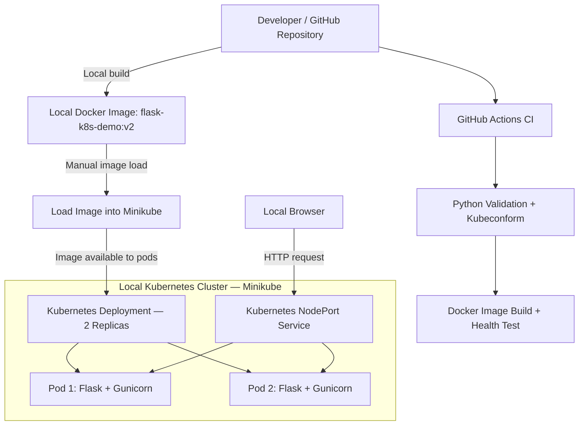

# Cloud-Native Platform Engineering — Architecture

## Overview

This project demonstrates containerized application delivery, Kubernetes orchestration, security hardening, application reliability, and automated continuous integration.

The application is deployed to a local Minikube Kubernetes cluster using Docker.

**Implementation Status:** Implemented & Tested

## Architecture Diagram



> GitHub Actions validates and tests the application and Docker image. Kubernetes deployment is performed manually in the local Minikube environment. Automated continuous deployment is not implemented.

## Application Architecture

**Application:** Python Flask REST API

**Runtime:** Gunicorn 23.0.0

**Container:** Docker using Python 3.12 slim

**Orchestration:** Kubernetes on Minikube

### API Endpoints

- `/` — Returns the application message, version, and pod hostname.
- `/health` — Returns the application's health status.

## Kubernetes Deployment

The application runs using:

- Two Kubernetes pod replicas
- Kubernetes NodePort Service
- Readiness and liveness probes
- CPU and memory requests and limits
- Rolling deployment updates
- Versioned Docker images

### Reliability

Readiness probes ensure pods are ready to receive traffic.

Liveness probes monitor application health and allow Kubernetes to restart unhealthy containers.

Rolling updates support controlled application version changes.

## Container Security

The container and Kubernetes deployment use security controls including:

- Dedicated non-root application user
- Container execution using UID 1000
- Privilege escalation disabled
- Linux capabilities dropped
- Python slim base image

## Continuous Integration

GitHub Actions runs automatically on pushes and pull requests targeting the `master` branch.

The CI workflow performs:

1. Repository checkout
2. Python 3.12 setup
3. Dependency installation
4. Python application syntax validation
5. Kubernetes manifest validation using Kubeconform
6. Docker image build
7. Container startup and HTTP health endpoint verification

## Deployment Workflow

The local deployment workflow uses the following commands:

```bash
docker build -t flask-k8s-demo:v2 .

minikube image load flask-k8s-demo:v2

kubectl apply -f k8s/deployment.yaml

kubectl apply -f k8s/service.yaml

kubectl rollout status deployment/flask-demo

kubectl get pods

minikube service flask-demo-service --url
```

## Technology Stack

| Layer | Technology |
|---|---|
| Application | Python, Flask |
| Production WSGI Server | Gunicorn |
| Containerization | Docker |
| Container Orchestration | Kubernetes |
| Local Kubernetes | Minikube |
| CI Automation | GitHub Actions |
| Manifest Validation | Kubeconform |
| Security | Non-root containers, Kubernetes securityContext |
| Health Monitoring | Kubernetes readiness and liveness probes |

## Engineering Outcomes

This hands-on implementation demonstrates:

- Containerized application delivery
- Kubernetes deployment and scaling
- Application health monitoring
- Secure container runtime configuration
- Resource management
- Automated build and validation pipelines
- Rolling updates and operational verification

## Scope

This is a local, hands-on platform engineering implementation.

It is not represented as a production cloud deployment, managed Kubernetes service, or automated CD pipeline.
